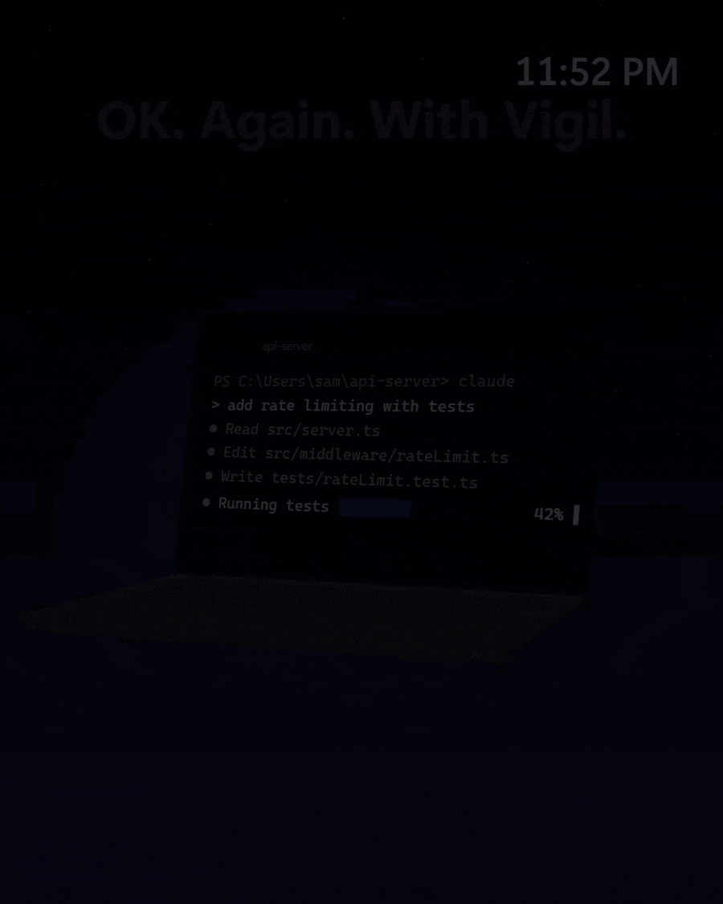

<p align="center"></p>

<h1 align="center">Vigil</h1>
<p align="center"><b>Close your laptop, let Claude Code keep working, and see what needs you the moment you get back.</b></p>

<p align="center">
  <a href="https://github.com/pjpamula-star/vigil/releases/latest"><b>Download for Windows</b></a> ·
  free and open source · no admin rights
</p>

<p align="center"></p>

|  | Turning sleep off | Keep-awake tools | Vigil |
|---|:---:|:---:|:---:|
| Claude keeps working with the lid closed | ✓ <sup>1</sup> | Not documented <sup>2</sup> | ✓ |
| Laptop sleeps again when Claude is done |  | ✓ | ✓ |
| Recap of what needs you and what finished |  |  | ✓ |
| Slows down or hibernates if it gets hot or the battery is low |  |  | ✓ |
| Restores your power settings, even after a crash |  | Not needed <sup>3</sup> | ✓ |
| Native Windows app, about 165 MB of RAM while working <sup>4</sup> |  |  | ✓ |

<sup>1</sup> Only if you also set "When I close the lid" to "Do nothing", and then the laptop never sleeps.
<sup>2</sup> Insomnia for Windows and claudfeine block sleep while Claude runs. Their docs do not say whether that holds with the lid closed.
<sup>3</sup> They do not change your power settings, so there is nothing to restore.
<sup>4</sup> Private working set, measured with one Claude Code session running.
Compared against each tool's public docs in October 2026.

## The problem

You start Claude Code on a long task at night and close the lid. Windows laptops use Modern Standby: a few minutes after the screen turns off, Windows suspends desktop apps, and that includes your terminal. In the morning the task is exactly where you left it.

You can turn sleep off. Then the laptop never sleeps, even when there is nothing left to do, and it can heat up in a bag.

Vigil sits between those. It keeps the laptop awake only while Claude is working, protects it while you are away, and lets it sleep when the work is done. When you come back, it tells you what needs you first.

## What it does

- Shows a recap when you unlock: sessions that need you first, then what finished, one line each, with the time.
- Keeps the PC awake only while a Claude Code session is working, with the lid open or closed, plugged in or on battery.
- Waits up to an hour when a session is waiting for your answer, then lets the PC sleep.
- Gives sleep back to Windows 2 minutes after the last session finishes. If the lid is closed, it puts the PC to sleep at that point (it hibernates on battery).
- If Windows starts throttling for heat, or the battery drops to 20%, it caps the CPU at 60%. If it is still too hot after 3 minutes, or the battery reaches 8%, it hibernates.
- Saves every power setting before it changes it and puts it back afterward. If Vigil crashes, the next start or a watchdog task that runs every 10 minutes restores them.
- Locks the PC when you close the lid while it is holding it awake.
- Writes one-line summaries of finished work with your own `claude` CLI (Haiku), so they use your Claude plan.
- Shows a pill in the taskbar with how many sessions need you, are working, and are done.
- Optional: follows OpenAI Codex CLI sessions too.
- Optional: an iPhone home screen app that shows the same status and notifies you when a session needs you or finishes.
- Optional: joins your phone's hotspot if the Wi-Fi drops while Claude works.

## Install

1. Download `Vigil.exe` from the [latest release](https://github.com/pjpamula-star/vigil/releases/latest). It is one self-contained file, so there is nothing else to install.
2. Move it somewhere permanent, for example `%LOCALAPPDATA%\Programs\Vigil\`, and run it.
3. Click **Connect**. Sessions that were already open show up after their next message.

Vigil is not code-signed yet, so Windows SmartScreen will warn you. Click **More info**, then **Run anyway**. Each release lists the SHA-256 of `Vigil.exe` so you can check the file.

### Build from source

You need the .NET 10 SDK.

```powershell
dotnet test tests/Vigil.Tests
dotnet publish src/Vigil/Vigil.csproj -c Release -o publish
.\publish\Vigil.exe --demo
```

`publish\Vigil.exe` is the same self-contained single file as the release. `--demo` runs Vigil with made-up sessions. It does not register hooks, read your sessions or change any power setting.

## Requirements

- Windows 11. Windows 10 is declared as supported but has not been tested yet.
- Claude Code. Codex CLI is optional.
- Nothing else. The .NET runtime is bundled inside `Vigil.exe`.

## What Vigil changes on your system

**Claude Code settings** (`%USERPROFILE%\.claude\settings.json`), when you click Connect:
- Hooks for `SessionStart`, `UserPromptSubmit`, `PermissionRequest`, `Notification`, `Stop`, `StopFailure`, `SubagentStart`, `SubagentStop` and `SessionEnd`, plus `PreToolUse`, `PostToolUse` and `PostToolUseFailure`, which run in the background. Each hook runs `cmd.exe` with `curl` to send the event to `http://127.0.0.1:47823/hook`. It times out after 5 seconds and always exits 0, so Claude never waits on Vigil or shows a hook error.
- `"remoteControlAtStartup": true`, so you can answer a session from the Claude app on your phone.
- An `env` entry, `CLAUDE_CLIENT_PRESENCE_FILE`, which tells Claude Code to skip phone notifications while you are at the PC.
- Before every write, a copy of the file goes to `%LOCALAPPDATA%\Vigil\claude-settings-backups`. The 20 most recent copies are kept.

**Codex settings** (`%USERPROFILE%\.codex\hooks.json`), only if you turn on Codex in Settings: the same kind of hook for `SessionStart`, `UserPromptSubmit`, `PermissionRequest`, `Stop`, `Interrupt`, `SubagentStart`, `SubagentStop`, `SessionEnd`, `PreToolUse` and `PostToolUse`. Codex runs only hooks you approve with `/hooks`.

**Power settings**, only while a session is working, on your active power plan, for both plugged in and battery:
- Sleep after: Never
- Hibernate after: Never
- When I close the lid: Do nothing
- A Windows power request that keeps the system running
- Maximum processor state: 60%, only while easing off for heat or low battery

The original values are written to `%LOCALAPPDATA%\Vigil\power-journal.json` before anything changes, and put back when the work is done. If Vigil stops unexpectedly, the next start restores them, and so does the watchdog.

**Startup and the watchdog**, when you click Connect:
- A per-user startup entry in `HKCU\Software\Microsoft\Windows\CurrentVersion\Run`.
- A per-user scheduled task named `Vigil power-settings watchdog`. Every 10 minutes it runs `Vigil.exe --restore-if-orphaned`, which restores your power settings only if Vigil is gone and its journal is still there.

**Vigil's own files** are all in `%LOCALAPPDATA%\Vigil`.

### Uninstall

1. In Settings, click **Disconnect**. This removes Vigil's hooks and the `CLAUDE_CLIENT_PRESENCE_FILE` entry from Claude Code's settings. Turn off Codex there too if you turned it on.
2. Disconnect does not remove the rest yet. In Settings, turn off **Reply from my phone in the Claude app** (removes `remoteControlAtStartup`) and **Start Vigil when I sign in** (removes the startup entry). Then remove the watchdog task:
   ```powershell
   schtasks /Delete /TN "Vigil power-settings watchdog" /F
   ```
3. Quit Vigil and delete `Vigil.exe` and `%LOCALAPPDATA%\Vigil`.

Your power settings are already back to normal whenever Vigil is not holding the PC awake.

## How it works

1. Claude Code fires a hook (for example, a prompt was sent, a tool ran, or Claude stopped) and `curl` posts it to Vigil on `127.0.0.1:47823`.
2. Vigil tracks each session as working, needs you, or done. It also reads Claude Code's own list of running sessions, because pressing Esc or closing a window sends no hook.
3. While any session is working, Vigil saves your power settings, applies the overrides above and holds a power request. It checks heat and battery every few seconds and eases off or hibernates if it has to.
4. When nothing is working, it waits up to an hour for any session that needs you, then 2 more minutes, then puts your settings back and lets the PC sleep.
5. When you unlock, it builds the recap from what each session did while you were away: what needs you first, then what finished, newest first.

## Why not just use a keep-awake tool?

Insomnia for Windows and claudfeine handle the sleep part well. If all you want is for Claude to keep running, they are a good choice. Vigil is for when you also want the laptop protected from heat and a dead battery while you are away, your power settings put back no matter what, and a clear answer to "what happened?" when you come back.

## Roadmap

- Code signing, so SmartScreen stops warning.
- A winget package.
- Testing the lid-closed and heat paths on more laptops. So far they have been tested on one.
- Testing Codex support with a real Codex install. It has been tested by running the hooks the way Codex does.

## Contributing

Issues and pull requests are welcome. If something looks wrong, please include your Windows version and what the recap showed.

## License

[MIT](LICENSE)
